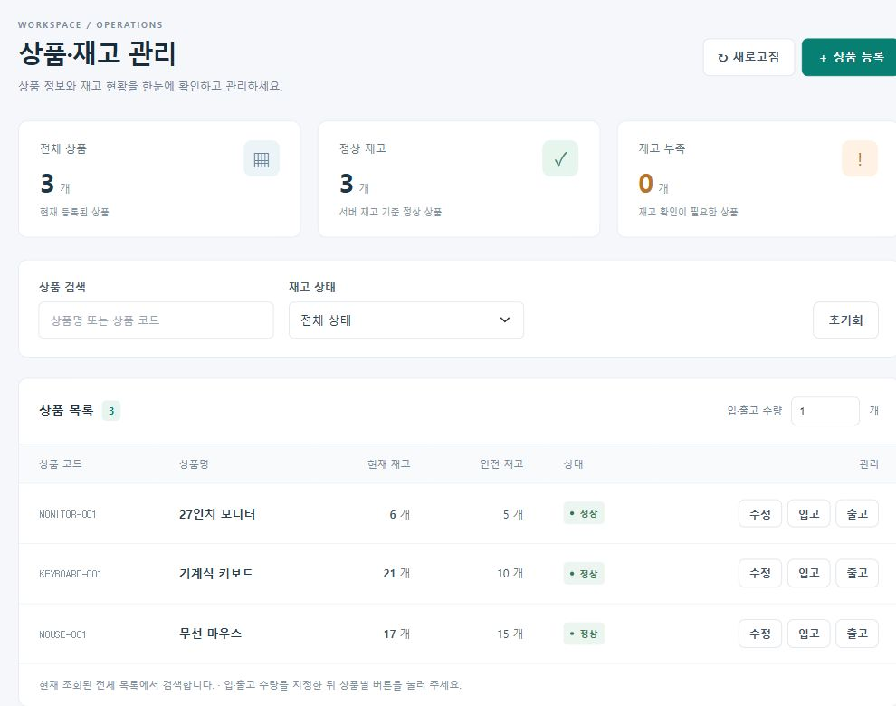
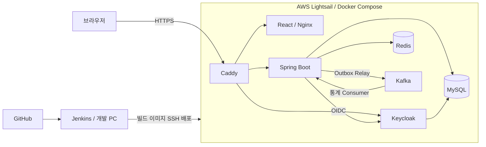
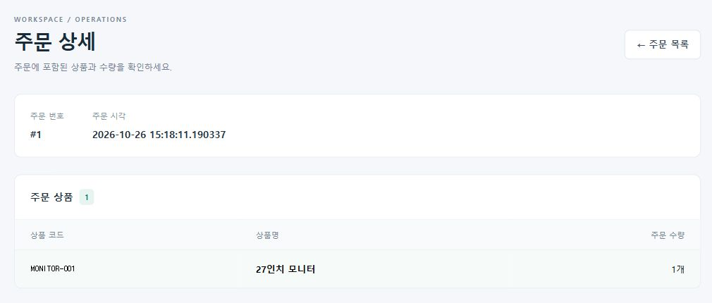
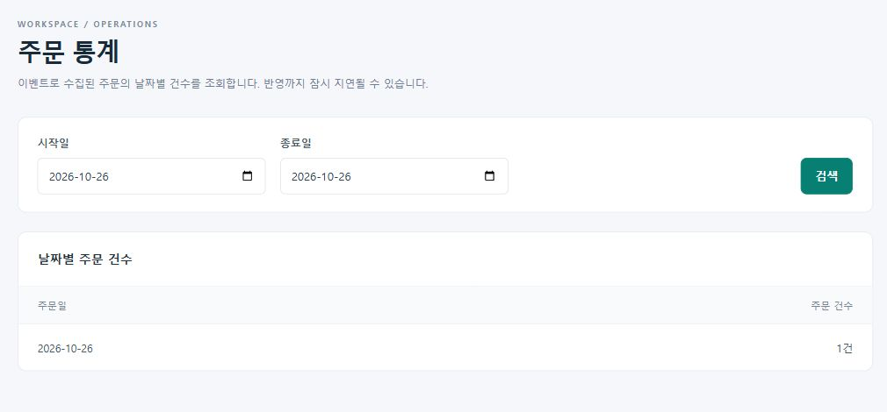

# Admin Portfolio | 주문·재고 운영 관리

주문과 재고의 정합성, 비동기 이벤트 처리, 인증·권한, 클라우드 배포를 구현한 백엔드 중심 개인 프로젝트입니다. React 관리 화면에서 업무 흐름을 직접 확인할 수 있습니다.

**[실행 서비스](https://13-124-81-142.sslip.io) · [프론트 저장소](https://github.com/whdcks0101-beep/admin-frontend) · [포트폴리오 PDF](output/pdf/admin-portfolio.pdf)**

## 공개 체험 계정

| 계정 | 아이디 | 비밀번호 | 로그인 방식 |
| --- | --- | --- | --- |
| 체험 관리자 | `demo-admin@example.com` | `PortfolioDemo2026!` | 이메일 / SSO |
| 일반회원 | `user1@gmail.com` | `normalUser1234` | 이메일 |

위 비밀번호는 공개 체험 전용입니다. 체험 관리자는 상품 등록·수정·입출고와 주문 기능을 사용할 수 있지만 회원 조회·등록·수정·삭제 및 권한 변경은 서버에서 차단됩니다. 운영 관리자 계정은 공개하지 않습니다. 공용 샘플 데이터는 다른 방문자가 변경할 수 있습니다.

[권한 비교와 체험 방법](docs/portfolio/demo-access.md)



## 핵심 구현

| 해결한 문제 | 적용한 설계 |
| --- | --- |
| 동시 재고 변경과 주문 실패 시 부분 저장 | JPA `@Version`, 주문·재고·Outbox의 단일 트랜잭션 |
| DB 저장 성공 후 이벤트 전송 실패 | Transactional Outbox, 재시도·선점 만료 복구 |
| 다중 Relay의 같은 작업 처리 | `FOR UPDATE SKIP LOCKED`, claim token, DB 시간 기반 소유권 검사 |
| 이벤트 재전송에 따른 통계 중복 | 주문 번호 고유키와 멱등 저장 |
| 외부 인증과 서비스 권한 구분 | Keycloak OIDC, `issuer + subject` 회원 연결, Spring Security |
| 인스턴스 간 세션·요청 횟수 공유 | Spring Session Redis, Lua 요청 제한 |
| 수동 배포의 반복 작업 | Jenkins 테스트·이미지 생성·SSH 전송·AWS healthcheck |

[핵심 구현 사례와 소스 보기](docs/portfolio/case-studies.md)

## 구성도



AWS에서는 Spring Boot 한 인스턴스와 MySQL·Redis·Kafka·Keycloak을 Compose로 실행합니다. 별도로 **로컬 Docker Desktop Kubernetes의 백엔드 2개 Pod**에서 세션 공유·자동 복구·롤링 업데이트·롤백을 실습했습니다.

[상세 구성도 및 주문·SSO 흐름](docs/portfolio/architecture.md)

## 주요 화면

- **상품·재고:** 상품 등록·수정, 안전재고, 입출고, 검색
- **주문:** 주문 생성, 기간·주문 번호 검색, 페이징, 상세 조회
- **통계:** Kafka 이벤트로 수집한 주문의 날짜별 건수
- **회원·인증:** 관리자 회원 관리, 일반 로그인, SSO, 권한별 접근 제어




화면은 2026-10-26 AWS 배포 서비스에서 캡처한 샘플 데이터입니다.

## 기술 구성

| 영역 | 기술 |
| --- | --- |
| Backend | Java 17, Spring Boot 4.1, Spring Data JPA, QueryDSL, Gradle |
| Data | MySQL 8.4, Flyway, Redis |
| Security | Spring Security, OAuth2/OIDC, Keycloak, Spring Session |
| Events | Apache Kafka, Spring Kafka, Transactional Outbox |
| Frontend | React, TypeScript, Vite, Bootstrap |
| Delivery | Docker, AWS Lightsail, Caddy, Jenkins, GitHub |
| Local orchestration | Docker Desktop Kubernetes |
| Tests | JUnit, Mockito, AssertJ, MockMvc, Embedded Kafka, Testcontainers |

## 실행 방법

JDK 17과 Docker Desktop을 준비합니다. `.env.example` 및 [환경변수 안내](docs/local-secrets.md)에 따라 DB·Keycloak 비밀값을 설정합니다. Spring Boot는 Compose의 `.env`를 자동으로 읽지 않으므로 Eclipse 또는 실행 셸에도 필요한 환경변수를 전달해야 합니다.

```powershell
docker volume create admin-api-kafka-data
docker compose up -d mysql redis kafka keycloak
.\gradlew.bat bootRun
```

로컬 Keycloak의 realm·client·사용자 연결을 준비해야 합니다. 프론트는 별도 저장소에서 `npm ci`, `npm run dev`로 실행합니다. 이미 Kubernetes나 다른 서버가 8080을 사용 중이면 실행 방식을 먼저 전환합니다.

- [로컬 개발·테스트 상세 안내](docs/local-development.md)
- [Docker·Kubernetes 실행](docs/deployment.md)
- [AWS 최초 구성과 계정 준비](deploy/lightsail/README.md)
- [Jenkins에서 AWS 배포](docs/jenkins.md)

## 검증

```powershell
.\gradlew.bat test
```

2026-10-26 로컬 기본 테스트 결과: **88개 중 69개 통과, 19개 조건부 건너뜀, 실패 0개**. MySQL·실제 Redis 통합 테스트는 별도 환경변수로 활성화합니다. 과거 실습 결과와 이 실행 결과를 구분합니다.

AWS에서 일반 로그인·SSO 로그인·로그아웃·관리자 권한·주문 생성·재고 차감·통계 반영을 확인했습니다. 이후 백엔드·프론트 Jenkins 배포 성공과 로그인·조회도 확인했습니다.

## 설계 문서

- [핵심 구현 사례](docs/portfolio/case-studies.md)
- [시스템 구성도](docs/portfolio/architecture.md)
- [Kafka·Outbox 상세 설계](docs/kafka-outbox.md)
- [제출용 PDF](output/pdf/admin-portfolio.pdf)

주문 이벤트 저장 경계에 `OrderEventStore` 포트와 Command/Result를 적용했습니다. 현재 서비스는 하나의 Spring Boot 애플리케이션이며, Kafka를 사용한다는 이유로 MSA로 표현하지 않습니다. Outbox는 재전송을 허용하고 통계 소비자에서 중복 반영을 방지합니다.