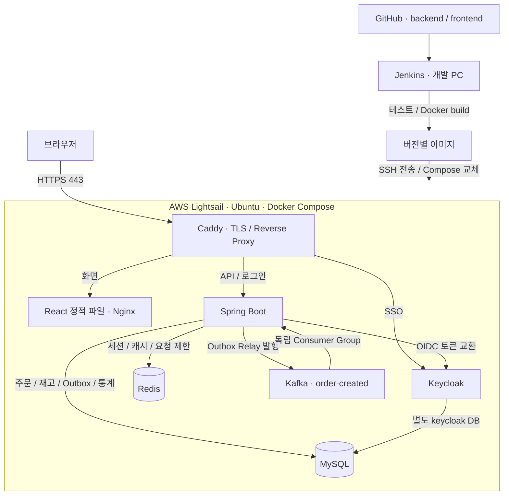
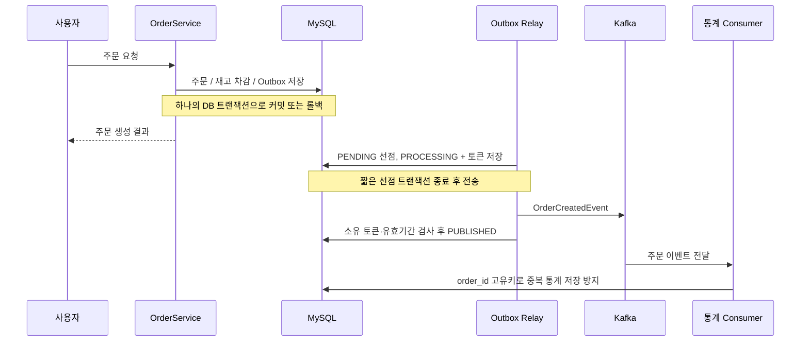
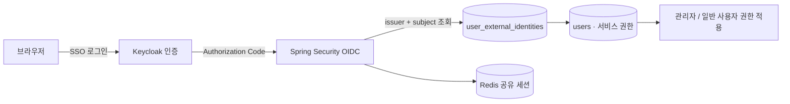

# 시스템 구성과 실행 흐름

## AWS 서비스 구성

AWS는 단일 Lightsail 서버의 Compose 구성이다. 공개 진입점은 Caddy의 80/443이며 백엔드·DB·Redis·Kafka는 내부 네트워크에서 통신한다. Keycloak의 관리 경로는 외부 Caddy에서 차단한다. HTTPS 인증서는 Caddy가 발급·갱신한다.

브라우저의 화면과 API는 같은 HTTPS 출처를 사용한다. Spring은 전달된 프록시 헤더로 원래 HTTPS 주소를 해석하며 세션 쿠키에는 Secure·HttpOnly를 적용한다.

## 주문 생성과 비동기 통계

Kafka 전송과 MySQL 완료 기록은 하나의 원자적 커밋이 아니다. 전송 성공 후 완료 기록이 실패하면 재전송될 수 있으므로, 통계 저장에서 동일 주문을 다시 반영하지 않도록 설계했다.

## SSO와 서비스 권한

Keycloak 계정과 서비스 회원은 별개다. 사전 등록한 계정만 연결하며 이메일 일치만으로 자동 연결하지 않는다. 서비스 관리자 권한은 Keycloak 관리 콘솔 권한과 구분한다.

## 로컬 Kubernetes 실습

Docker Desktop Kubernetes에서 동일 백엔드 Deployment를 2개 Pod로 실행했다. Redis 세션 공유, Pod 재생성, readiness/liveness, 롤링 업데이트와 롤백을 확인했다. 이 구성은 로컬 실습이며 AWS EKS 배포나 여러 물리 서버 구성으로 표현하지 않는다.
