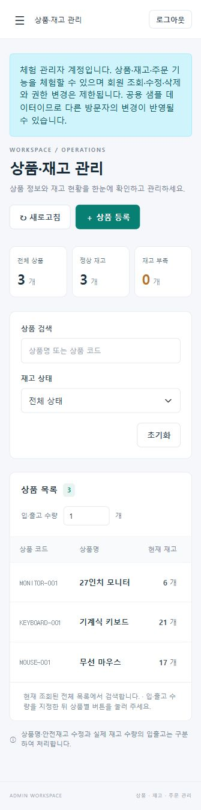

# 공개 체험 계정과 권한 비교

[AWS 서비스 열기](https://13-124-81-142.sslip.io)

| 구분 | 아이디 | 공개 체험용 비밀번호 | 로그인 방식 |
| --- | --- | --- | --- |
| 체험 관리자 | `demo-admin@example.com` | `PortfolioDemo2026!` | 이메일 로그인 / SSO |
| 일반회원 | `user1@gmail.com` | `normalUser1234` | 이메일 로그인 |

실제 운영 관리자와 체험 계정은 분리한다. 위 비밀번호는 의도적으로 공개하는 체험 전용 값이며 다른 시스템의 인증정보로 사용하지 않는다.

| 기능 | 운영 관리자 | 체험 관리자 | 일반회원 |
| --- | --- | --- | --- |
| 상품·재고 조회 | 허용 | 허용 | 허용 |
| 주문 생성·조회·통계 | 허용 | 허용 | 허용 |
| 상품 등록·수정·입출고 | 허용 | 허용 | 거부 |
| 회원 조회·등록·수정·삭제 | 허용 | 거부 | 거부 |
| 회원 권한 변경 | 허용 | 거부 | 거부 |

체험 관리자에게는 `ROLE_DEMO_ADMIN`, `ROLE_USER`만 부여한다. `ROLE_ADMIN`은 부여하지 않는다. 회원 API는 모든 메서드에서 운영 관리자만 접근할 수 있다. 상품 변경은 허용할 HTTP 메서드와 경로를 명시하므로 새 관리 API를 추가해도 체험 관리자에게 자동으로 권한을 주지 않는다.

## 확인 방법

1. 체험 관리자로 로그인하면 상단에 체험 관리자 표시와 안내문이 나온다.
2. 상품·재고에서 상품 등록·수정·입출고 기능을 확인한다. 공용 샘플 데이터이므로 다른 방문자의 변경도 반영된다.
3. 회원 관리 메뉴는 표시되지 않는다. `/users` 직접 접근은 프론트에서 제한하고 `/api/users` 직접 호출은 서버가 403으로 거부한다.
4. 로그아웃 후 일반회원으로 로그인하면 상품 변경 버튼이 표시되지 않는다. API로 직접 변경해도 403으로 거부한다.
5. 체험 관리자 SSO 로그인도 동일 서비스 회원으로 연결되므로 같은 제한을 적용한다.

`DemoAdminSecurityTest`는 유효한 CSRF가 있는 요청으로도 회원 API의 GET/POST/PUT/DELETE가 403이고 서비스가 호출되지 않는지 검증한다. 운영·체험 관리자의 상품 변경 허용, 일반회원의 변경 거부, CSRF 누락과 미허용 API 차단도 확인한다. `UserAuthorityMapperTest`는 체험 관리자에게 운영 관리자 권한이 포함되지 않음을 확인한다.

공개 체험 계정은 서로 격리된 데이터 공간이 아니다. 상품·재고·주문은 공유하며 데이터 자동 초기화는 적용하지 않았다. 계정 관리만 분리한 설계다.

## AWS 검증 기록 (2026-10-27)

- 체험 관리자 이메일 로그인 및 Keycloak SSO 로그인 성공. `ROLE_DEMO_ADMIN` 적용, `ROLE_ADMIN` 미포함 확인.
- 체험 관리자·일반회원 모두 유효한 CSRF 토큰을 사용한 회원 API GET/POST/PUT/DELETE 요청이 403으로 거부됨.
- 빈 상품 등록 요청은 체험 관리자에게 입력 검증 400, 일반회원에게 권한 거부 403을 반환. 이 확인 과정에서는 상품 데이터를 생성하지 않음.
- 실제 체험 관리자 화면에서 상품 등록·수정·입출고 버튼과 제한 안내 표시, 회원 관리 메뉴 미표시 확인.
- 두 컨테이너 healthy 확인. 이번 반영은 로컬에서 테스트한 이미지를 SSH로 전달하고 기존 `apply-image.sh`로 적용했으며 Jenkins 실행 결과와 구분함.

